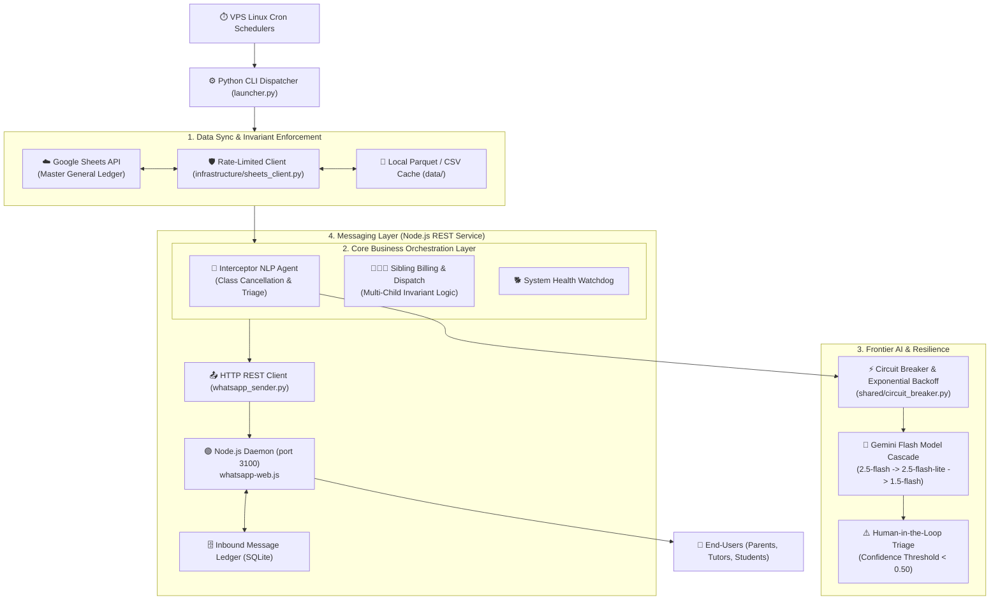

# ⚡ Ítaca Autonomous Operations Platform — Event-Driven Architecture & LLM Agents

[](https://python.org)
[](whatsapp-service/)
[](https://ai.google.dev/)
[](#resilience--fault-tolerance)
[](LICENSE)

> An end-to-end event-driven operations platform and autonomous AI agent system engineered for **Academia Ítaca** (education marketplace scaled to **220+ tutors**, **150+ active students**, and approaching **€40k ARR** with **100% autonomous operations** and zero administrative overhead).

---

## 🏛️ System Architecture

The platform operates on a decoupled microservices architecture designed to isolate volatile third-party protocols while maintaining high-throughput business orchestration:



---

## 📊 Operational Scale & Highlights

| Dimension | Metric / Architecture Decision |
| :--- | :--- |
| **Operational Autonomy** | **100% autonomous**: zero administrative staff; all scheduling, billing, and reminders run autonomously |
| **Active Network** | **220+ verified tutors**, **150+ active students**, managing peak weekly class flows |
| **Revenue Scale** | Bootstrapped from €0 to **approaching €40,000 ARR** with zero venture funding |
| **NLP Agent Throughput** | Processes all unstructured inbound messages, auto-cancelling with **$\ge 0.50$ confidence threshold** |
| **Fault Tolerance** | Redundant circuit breakers and exponential backoff preventing external API cascading failures |
| **Regulatory Compliance** | Bitset-accelerated Subset Sum algorithm balancing transactions under statutory bank limits |

---

## ⚡ Engineering Innovations

### 1. The Interceptor NLP Agent (`workflows/interceptor.py`)
Unstructured messaging apps are notoriously noisy. Parents message: *"Mateo has a fever and won't make it at 17:30"*.
- **Model Cascades**: Evaluates prompts across a cascade of models (`gemini-2.5-flash`, `gemini-1.5-flash`) to maximize solve rate while eliminating rate-limit spikes.
- **Confidence Routing**:
  $$\text{Confidence} \ge 0.50 \implies \text{Automated schedule cancellation and database update}$$
  $$\text{Confidence} < 0.50 \implies \text{Automated triage alert dispatched to Admin phone}$$

### 2. Circuit Breaker Pattern (`shared/circuit_breaker.py`)
Protects against third-party network partitions (Google Sheets rate limits or LLM API degradation):
```python
@circuit_breaker(failure_threshold=3, recovery_timeout=60, backoff_factor=2)
def query_llm_inference(prompt: str) -> dict:
    # Fails fast if external API is degraded, preventing execution hanging
    ...
```

### 3. Decoupled Communication Daemon (`whatsapp-service/`)
WhatsApp protocols require persistent WebSocket connections. 
- Python execution jobs remain ephemeral and lightweight.
- A long-running **Node.js microservice** manages sessions, incoming socket traffic, and local SQLite state persistence, exposing an authenticated HTTP REST interface on `localhost:3100`.

---

## 🚀 Quickstart & Standalone Demo

### 1. Run the NLP Agent Simulation
To test the message classification logic without live WhatsApp credentials:
```bash
python demo_agent_interceptor.py
```

### 2. Setup Dependencies (via uv)
```bash
# Clone the repository
git clone https://github.com/MiguelMartinVieira/itaca-autonomous-platform.git
cd itaca-autonomous-platform

# Install dependencies
uv sync
```

### 3. Configuration
Copy `.env.example` to `.env` and provide your API keys:
```bash
cp .env.example .env
```

---

## 📁 Repository Structure

```
itaca-autonomous-platform/
├── launcher.py               # Main CLI job orchestrator
├── demo_agent_interceptor.py # Standalone demonstration harness
├── config/
│   ├── settings.py           # Centralized configuration & environment loader
│   └── .env.example          # Template environment file
├── infrastructure/
│   ├── whatsapp_sender.py    # HTTP client adapter for messaging daemon
│   ├── sheets_client.py      # Rate-limited Google Sheets singleton
│   ├── admin_notifier.py     # Email & instant alert dispatcher
│   └── data_updater.py       # Cache sync worker
├── shared/
│   ├── circuit_breaker.py    # Resilient circuit breaker implementation
│   ├── retry_utils.py        # Exponential backoff decorator
│   ├── persistent_state.py   # Atomic state watermarking
│   └── text_utils.py         # String sanitization & normalization
├── workflows/
│   ├── interceptor.py        # Gemini Flash NLP cancellation agent
│   ├── padres.py             # Sibling grouping & billing dispatcher
│   └── whatsapp_watchdog.py  # Health monitoring daemon
├── whatsapp-service/
│   ├── index.js              # Node.js REST API microservice
│   └── package.json          # Dependencies for whatsapp-web.js
├── pyproject.toml            # Project packaging & tooling
└── README.md                 # Technical architecture blueprint
```
