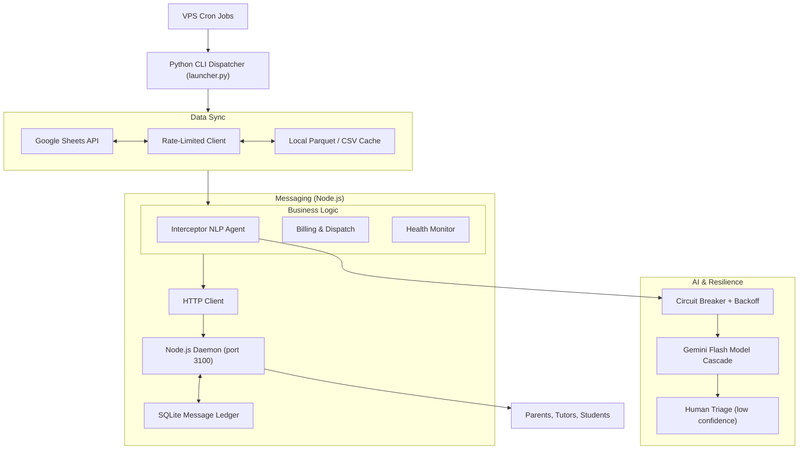

# Ítaca Autonomous Operations Platform

[](https://python.org)
[](LICENSE)

The backend that runs [Academia Ítaca](https://itacacademia.com) — a tutoring marketplace with 220+ tutors, 150+ active students, and ~€40k in annual revenue. The entire operation (scheduling, billing, cancellation handling, teacher payouts, parent notifications) runs autonomously with zero admin staff.

## Architecture

The system is split into a Python orchestration layer and a Node.js messaging daemon, connected over local HTTP:



## How it works

### The Interceptor Agent (`workflows/interceptor.py`)

Parents send messages like *"Mateo has a fever and won't make it at 17:30"*. The interceptor agent:

1. Runs the message through a Gemini Flash model cascade (`2.5-flash` → `1.5-flash`)
2. If confidence ≥ 0.50: auto-cancels the session and updates the database
3. If confidence < 0.50: routes to my phone for manual review

### Circuit Breaker (`shared/circuit_breaker.py`)

External APIs go down. Google Sheets rate-limits you. The circuit breaker prevents cascading failures:

```python
@circuit_breaker(failure_threshold=3, recovery_timeout=60, backoff_factor=2)
def query_llm_inference(prompt: str) -> dict:
    ...
```

### Messaging Daemon (`whatsapp-service/`)

WhatsApp needs persistent WebSocket connections, which doesn't mix well with ephemeral cron jobs. Solution: a long-running Node.js process manages the session and exposes a REST API on `localhost:3100`. Python jobs stay lightweight and stateless.

## Running the demo

You can test the NLP classification logic without any credentials:

```bash
git clone https://github.com/MiguelMartinVieira/itaca-autonomous-platform.git
cd itaca-autonomous-platform
python demo_agent_interceptor.py
```

For the full setup:
```bash
uv sync
cp .env.example .env
# Fill in your API keys
```

## Project structure

```
itaca-autonomous-platform/
├── launcher.py               # CLI job orchestrator
├── demo_agent_interceptor.py  # Standalone demo (no credentials needed)
├── config/
│   ├── settings.py            # Environment loader
│   └── .env.example
├── infrastructure/
│   ├── whatsapp_sender.py     # HTTP adapter for messaging daemon
│   ├── sheets_client.py       # Rate-limited Sheets singleton
│   ├── admin_notifier.py      # Alert dispatcher
│   └── data_updater.py        # Cache sync
├── shared/
│   ├── circuit_breaker.py     # Circuit breaker implementation
│   ├── retry_utils.py         # Exponential backoff
│   ├── persistent_state.py    # State watermarking
│   └── text_utils.py          # String normalization
├── workflows/
│   ├── interceptor.py         # NLP cancellation agent
│   ├── padres.py              # Billing dispatcher
│   └── whatsapp_watchdog.py   # Health monitor
├── whatsapp-service/
│   ├── index.js               # Node.js REST microservice
│   └── package.json
└── pyproject.toml
```

## License

MIT
